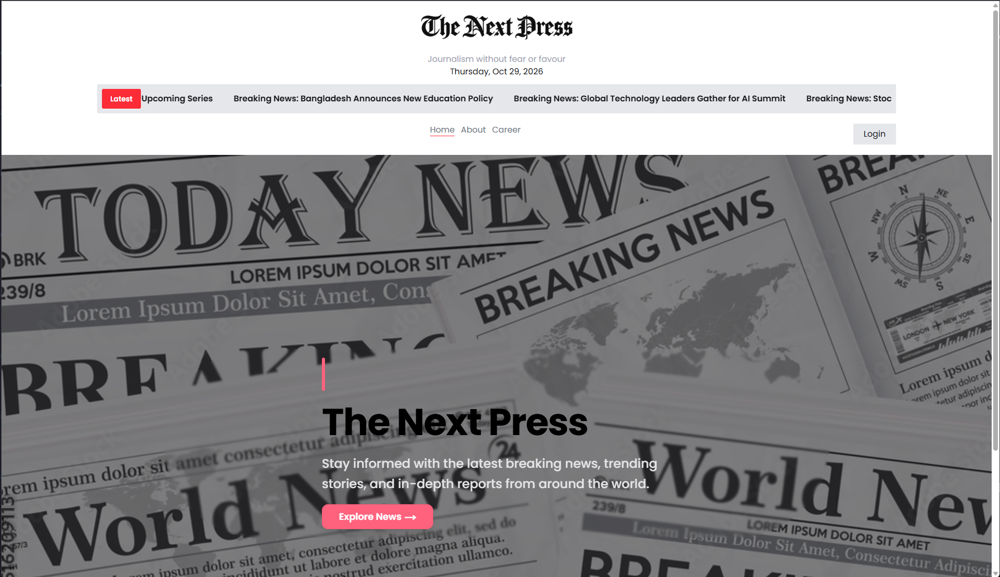
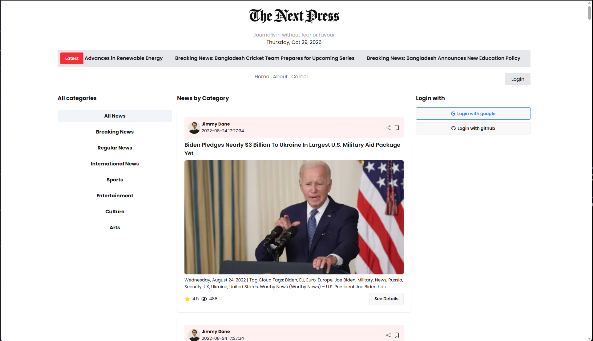
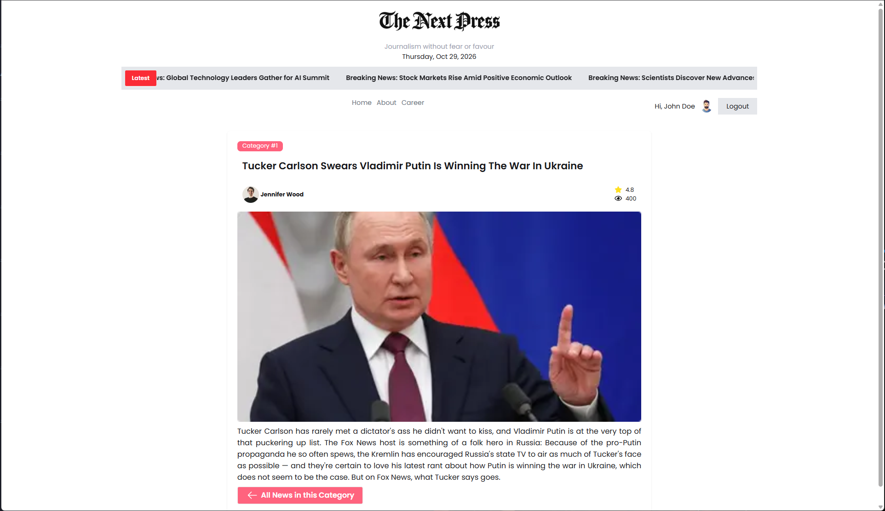
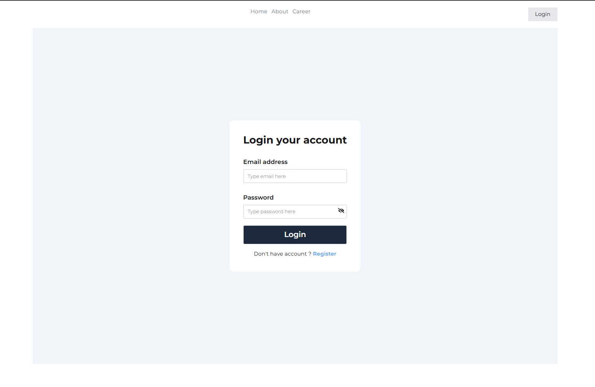
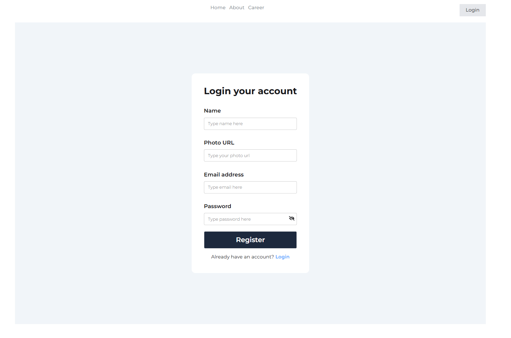
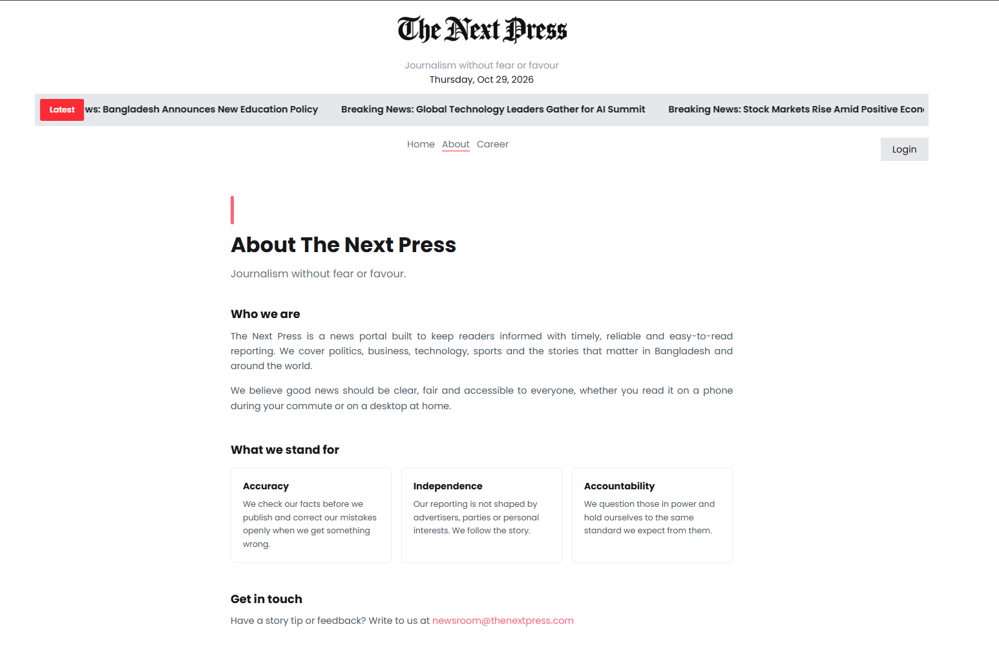
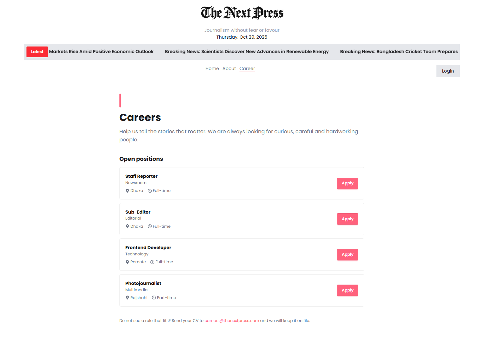

# The Next Press

**A modern news platform built with Next.js, DaisyUI, Better Auth, and
MongoDB.**

[](https://the-next-press.vercel.app/)
[](https://github.com/sazidrafi/The-Next-Press)

The Next Press is a modern news platform where users can explore news
from different categories, view individual news articles, and access
protected pages after signing in.

The application fetches news from an external news API and uses Better
Auth for authentication, with MongoDB storing user information.

**Live Website:** https://the-next-press.vercel.app/

**Repository:** https://github.com/sazidrafi/The-Next-Press

------------------------------------------------------------------------

## Screenshots

Here is the short overview of the project through different pages,

### Home Page



### News Page



### News Details Page



### Login Page



### Register Page



### About Page



### Career Page



------------------------------------------------------------------------

## Features

-   **Home page:** A landing page introducing The Next Press.
-   **News exploration:** Browse news fetched from an external news API.
-   **Category-based browsing:** Select a news category from the left
    sidebar to explore related articles.
-   **News details:** Open an individual news article on its dedicated
    details page.
-   **User registration and login:** Create an account and sign in using
    email and password.
-   **Google authentication:** Sign in using a Google account.
-   **GitHub authentication:** Sign in using a GitHub account.
-   **Protected routes:** The Career page and individual News Details
    pages require authentication.
-   **MongoDB integration:** User information is stored in MongoDB.
-   **Responsive interface:** User interface built with Tailwind CSS and
    DaisyUI.

------------------------------------------------------------------------

## Technology Stack

  Technology          Purpose
  ------------------- -----------------------------------------------------
  Next.js             React framework, routing, and application structure
  React               Building user interfaces
  Tailwind CSS        Utility-first styling
  DaisyUI             UI components and styling
  Better Auth         Email/password and social authentication
  MongoDB             Storing user information
  External News API   Fetching news content
  Vercel              Deployment and hosting

------------------------------------------------------------------------

## Project Structure

``` text
The-Next-Press/
├── public/
|   ├── images/
├── src/
│   ├── app/
│   │   ├── (auth)/
│   │   │   ├── login/
│   │   │   │   └── page.jsx
│   │   │   ├── register/
│   │   │   │   └── page.jsx
│   │   │   └── layout.jsx
│   │   ├── (main)/
│   │   │   ├── aboutus/
│   │   │   │   └── page.jsx
│   │   │   ├── career/
│   │   │   │   └── page.jsx
│   │   │   ├── category/
│   │   │   │   └── [id]/
│   │   │   │       ├── loading.jsx
│   │   │   │       └── page.jsx
│   │   │   ├── news/
│   │   │   │   └── [id]/
│   │   │   │       └── page.jsx
│   │   │   ├── layout.jsx
│   │   │   └── page.jsx
│   │   ├── api/
│   │   │   └── auth/
│   │   │       └── [...all]/
│   │   │           └── route.js
│   │   ├── favicon.ico
│   │   ├── globals.css
│   │   ├── layout.js
│   │   ├── loading.jsx
│   │   └── not-found.jsx
│   ├── assets/
│   ├── components/
│   │   ├── homepage/
│   │   │   └── news/
│   │   │       ├── LeftSidebar.jsx
│   │   │       ├── NewsCard.jsx
│   │   │       └── RightSidebar.jsx
│   │   ├── shared/
│   │   │   ├── BreakingNews.jsx
│   │   │   ├── Header.jsx
│   │   │   ├── Navbar.jsx
│   │   │   ├── NavLink.jsx
│   │   │   ├── ToastProvider.jsx
│   │   │   └── NoNewsFound.jsx
│   └── lib/
│       ├── auth-client.js
│       ├── auth.js
│       ├── data.js
│       └── proxy.js
├── .gitignore
├── package.json
├── package-lock.json
└── README.md
```

*This is an overview based on the project structure. Configuration files
not shown in the screenshot may also exist in the repository.*

------------------------------------------------------------------------

## Authentication and Protected Routes

The Next Press uses **Better Auth** to manage user authentication.

### Available sign-in methods

-   Email and password
-   Google OAuth
-   GitHub OAuth

### MongoDB

MongoDB is used to store user information through the Better Auth
integration.

### Protected routes

The application uses Next.js Proxy-based route protection.

  Page                          Access
  ----------------------------- --------------------------
  Home                          Public
  About                         Public
  News listing and categories   Public
  Login                         Public
  Register                      Public
  Career                        Authenticated users only
  Individual news details       Authenticated users only

When a user who is not signed in tries to access a protected page, they
are redirected to the login page.

------------------------------------------------------------------------

## Getting Started

Follow these steps to run the project on your local machine.

### Prerequisites

Make sure you have the following:

-   [Node.js](https://nodejs.org/)
-   npm
-   [Git](https://git-scm.com/)
-   A MongoDB database (for example, MongoDB Atlas)
-   Google OAuth credentials (if you want to use Google sign-in)
-   GitHub OAuth credentials (if you want to use GitHub sign-in)

### 1. Clone the repository

``` bash
git clone https://github.com/sazidrafi/The-Next-Press.git
```

### 2. Open the project directory

``` bash
cd The-Next-Press
```

### 3. Install dependencies

``` bash
npm install
```

### 4. Set up environment variables

Create a file named `.env.local` in the root directory of the project.

Add your own credentials:

``` env
BETTER_AUTH_SECRET=your_better_auth_secret
BETTER_AUTH_URL=http://localhost:3000

MONGO_URI=your_mongodb_connection_string

GOOGLE_CLIENT_ID=your_google_client_id
GOOGLE_CLIENT_SECRET=your_google_client_secret

GITHUB_CLIENT_ID=your_github_client_id
GITHUB_CLIENT_SECRET=your_github_client_secret
```

Replace the placeholder values with your own credentials. Do not add
real credentials to this README or commit `.env.local` to GitHub.

**Important:** The OAuth applications must be configured with the
correct local callback URLs. For production, configure the corresponding
production URLs in Google, GitHub, and Vercel.

### 5. Start the development server

``` bash
npm run dev
```

Open <http://localhost:3000> in your browser.

### 6. Create a production build

``` bash
npm run build
```

To run the production build locally:

``` bash
npm run start
```

------------------------------------------------------------------------

## Deployment

The Next Press is deployed on **Vercel**.

**Live URL:** https://the-next-press.vercel.app/

To deploy your own instance:

1.  Fork or clone this repository.
2.  Import the repository into [Vercel](https://vercel.com/).
3.  Add the required environment variables in the Vercel project
    settings.
4.  Configure Google and GitHub OAuth settings for your deployment
    domain.
5.  Deploy the application.

For more information, see the [Vercel
documentation](https://vercel.com/docs).

------------------------------------------------------------------------

## Adding Screenshots

To add your own screenshots:

1.  Open the `public` folder in the project.
2.  Open folder named `images`.
3.  Put your screenshots inside that folder.
4.  Use Markdown image syntax in this README.

For example, if your homepage screenshot is saved as
`public/images/homepage.png`, add:

``` markdown

```

Suggested screenshot filenames:

``` text
public/
└── images/
    ├── homepage.png
    ├── news-page.png
    ├── news-details.png
    ├── login-page.png
    ├── register-page.png
    ├── about-page.png
    └── career-page.png
```

After adding the images, commit and push them to GitHub so they appear
in the repository README.

------------------------------------------------------------------------

## Project Purpose

The Next Press was developed as a practical project to apply modern
frontend development concepts, including:

-   Building a multi-page application with Next.js.
-   Fetching and displaying news from an external API.
-   Organizing news content by category.
-   Implementing email/password and social authentication with Better
    Auth.
-   Integrating MongoDB for user information storage.
-   Protecting selected routes with Next.js Proxy.
-   Building reusable components and responsive layouts with React,
    Tailwind CSS, and DaisyUI.

------------------------------------------------------------------------

## Author

**Md. Sazidul Islam**

CSE Graduate \| Frontend Developer

-   GitHub: [@sazidrafi](https://github.com/sazidrafi)
-   Project Repository: [The Next
    Press](https://github.com/sazidrafi/The-Next-Press)

------------------------------------------------------------------------

## License

This project was created for educational and portfolio purposes.

No open-source license has been specified. Unless a license is added to
the repository, all rights are reserved by the author.

------------------------------------------------------------------------

**Built with ❤️ using Next.js and modern web technologies.**
